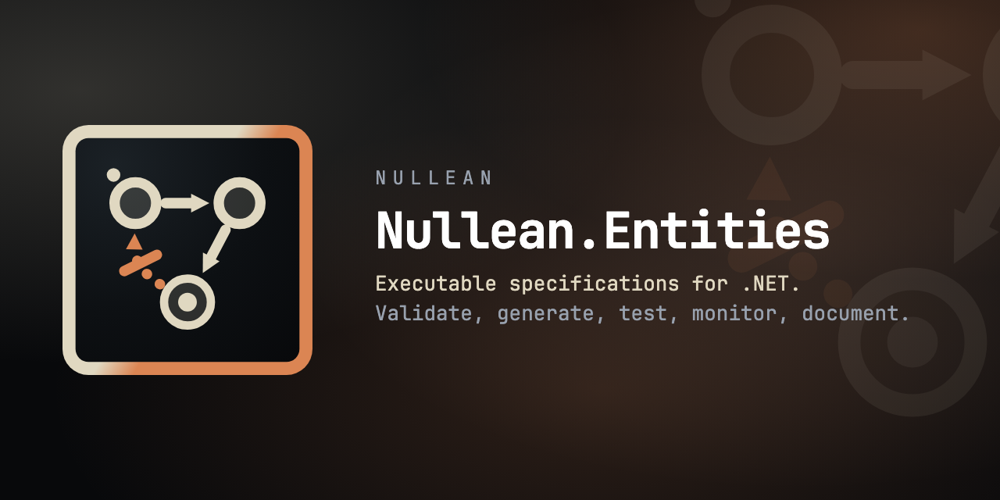

# Nullean.Entities.ReactiveUI



**Your form shows "must contain @" next to the email field, using the rules your domain type already has, with the `BindValidation` calls you already write.**

[](https://www.nuget.org/packages/Nullean.Entities.ReactiveUI)

Without this package, a ReactiveUI view model repeats its domain's rules as `this.ValidationRule(...)` calls, one per property, and they drift apart. This package checks the
domain type's `Nullean.Entities` constraint set on every property change of the view model and reports the violations on its ReactiveUI.Validation `ValidationContext`.

It builds on [Nullean.Entities](https://www.nuget.org/packages/Nullean.Entities) and [ReactiveUI.Validation](https://www.nuget.org/packages/ReactiveUI.Validation); it does
not need the other integration packages. It is not the same thing as `Nullean.Entities.Reactive`, which checks rules over System.Reactive event streams.

## Install

Targets `net10.0` and `net11.0`. Built against ReactiveUI 26.0.1 and ReactiveUI.Validation 8.1.0.

```bash
dotnet add package ReactiveUI.Validation
dotnet add package Nullean.Entities
dotnet add package Nullean.Entities.ReactiveUI
```

## Quick start

The rules live on the domain type. A violation names its member; a rule about the whole value has none:

```csharp
using Nullean.Entities;

public sealed partial record SignUp(string Email, int Age, string Password, string Confirm)
{
	[Constraint]
	public static readonly Constraint<SignUp> EmailHasAt = Constraints<SignUp>.Check(
		s => s.Email.Contains('@') ? [] : [Violation.Error(nameof(Email), "must contain @")]
	);

	[Constraint]
	public static readonly Constraint<SignUp> PasswordsMatch = Constraints<SignUp>.Check(
		s => s.Password == s.Confirm ? [] : [Violation.Error("passwords must match")]
	);
}
```

The view model is a plain `ReactiveObject` with a `ValidationContext`, and one method that builds the domain value from what is on screen:

```csharp
using ReactiveUI;
using ReactiveUI.Validation.Abstractions;
using ReactiveUI.Validation.Contexts;

public sealed class SignUpViewModel : ReactiveObject, IValidatableViewModel
{
	private string _email = "";
	public string Email { get => _email; set => this.RaiseAndSetIfChanged(ref _email, value); }
	// Age, Password, Confirm the same way

	public IValidationContext ValidationContext { get; } = new ValidationContext();

	public SignUp ToSignUp() => new(Email, Age, Password, Confirm);
}
```

Attach the rules, usually in the view model's constructor, and keep the `IDisposable` for as long as the view model lives:

```csharp
using Nullean.Entities.ReactiveUI;

var rules = vm.ValidateConstraints(SignUp.Constraints, v => v.ToSignUp());

vm.Email = "not-an-email";
// vm.ValidationContext.IsValid == false, vm.ValidationContext.Text == "must contain @"
```

And bind in the view, as with any ReactiveUI.Validation rule:

```csharp
view.BindValidation(view.ViewModel, x => x.Email, v => v.EmailError);   // "must contain @", empty once fixed
view.BindValidation(view.ViewModel, v => v.FormErrors);                 // every message, including "passwords must match"
```

The value: the rule is written once, on `SignUp`. The same set guards the service that saves the sign-up, the HTTP endpoint and the generated tests, and the form
shows exactly what the server would reject.

## What you get

- `ValidateConstraints<TViewModel, T>(this TViewModel viewModel, ConstraintSet<T> constraints, Func<TViewModel, T> project, ConstraintValidationOptions? options = null)`
  where `TViewModel : class, INotifyPropertyChanged, IValidatableViewModel`. Returns an `IDisposable`; dispose it to stop validating and remove the components.
- Validates right away, then once per `PropertyChanged`. One validation pass feeds every component.
- A violation with a member goes to a property component for that member, which `BindValidation(vm => vm.Email, ...)` and `ValidationContext.ObserveFor(vm => vm.Email)`
  find. A nested member (`"Address.City"`) matches `vm => vm.Address.City`.
- A violation without a member makes `ValidationContext.IsValid` false and is in `ValidationContext.Text`, on no property.
- `ConstraintValidationOptions`:
  - `MinimumSeverity` (default `Severity.Error`): include warnings (`Warning`) or everything (`Hint`). An included warning blocks like an error; ReactiveUI.Validation has
    no other state.
  - `PropertyFor`: maps a domain member to the view model property it is shown on, when the names differ. Return `null` to show it on the view model as a whole.
  - `Time`: the clock for time-aware rules (`NotInFuture`, `Always((x, now) => ...)`). Defaults to `TimeProvider.System`.

## Pitfalls and limits

- Every property change re-validates, including properties the rules do not read. Keep the projection cheap and make it not throw: it runs inside the property setter.
- Point-in-time rules only: `Validate` skips sequential rules (`Monotonic`, transitions), as a form has no previous value.
- A property's component appears the first time that property has a violation, and stays (valid) after. Bindings pick it up when it appears.
- `ObserveFor` with an `Expression<Func<TViewModel, object>>` boxes an `int` property, and ReactiveUI.Validation then finds no property. Let the type be inferred.
- ReactiveUI 26 needs `RxAppBuilder.CreateReactiveUIBuilder().WithCoreServices().BuildApp()` before `BindValidation` works. Your app already does this.
- Not trim or NativeAOT clean. This package uses no reflection, but ReactiveUI.Validation's `ValidationContext` constructors and `BindValidation` require unreferenced
  and dynamic code.
- Tested with ReactiveUI 26.0.1 and ReactiveUI.Validation 8.1.0; other versions are untested.

## Learn more

- This integration on the docs site: https://entities.nullean.net/integration/reactiveui/, and every integration: https://entities.nullean.net/integration/
- Getting started with constraints: https://entities.nullean.net/getting-started/
- ReactiveUI.Validation: https://github.com/reactiveui/ReactiveUI.Validation
- Rules over event streams (a different package): https://www.nuget.org/packages/Nullean.Entities.Reactive
- Tests for the package: https://github.com/nullean/entities/tree/main/tests/Nullean.Entities.ReactiveUI.Tests
- Source and issues: https://github.com/nullean/entities
